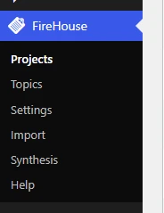

# Getting started

<!-- help audience: editors; screens: project-list -->

What the FireHouse part of WordPress holds, who can change what, and where to find help.

## What you look after

The FireHouse is a section of the site at /firehouse/. In WordPress you look after four things:

- **Projects:** one for each research project a researcher submitted through the survey. You review each one, add a few words of your own, and decide when it's published.
- **Topic areas:** the four areas the needs are grouped into, such as Warnings and Immediate Response. You keep their short names and descriptions up to date.
- **The synthesis:** the top needs in each topic area, across all the published projects. You make it in NotebookLM, check it, and publish it.
- **The landing and About pages:** their headings, text and buttons, and the About page's team.

## The FireHouse menu

Everything is under **FireHouse** in the menu on the left of the dashboard.

- **Projects** lists every project. Choose a title to open it.
- **Topics** lists the four topic areas.
- **Settings** holds the site name, the Submit a Finding button and the navigation labels.
- **Import** loads content from the survey's records. Only administrators see it.
- **Synthesis** is where you publish a reviewed synthesis.
- **Help**, at the end, is this guide.

The landing and About pages are under **Pages**, as "The FireHouse" and the page under it.

## What a FireHouse Editor can and can't do

The FireHouse Editor role can change the FireHouse and nothing else on the site:

- You can edit and publish projects, edit the topic areas, change the words on the landing and About pages, change the FireHouse settings, and publish a synthesis.
- You can't change the site's other pages or posts, add or remove pages, or upload images. An administrator does those.
- You can't change what a researcher wrote. Their answers are shown exactly as they submitted them.

## Getting help

On each FireHouse screen, choose **Help** at the top right of the screen. It opens the part of this guide for that screen. FireHouse → Help has the whole guide, with screenshots. The editor for the landing and About pages has no Help tab: see [Changing the landing and About pages](05-landing-and-about-pages.md).

> This guide comes with the plugin, so it matches the version installed on this site.
