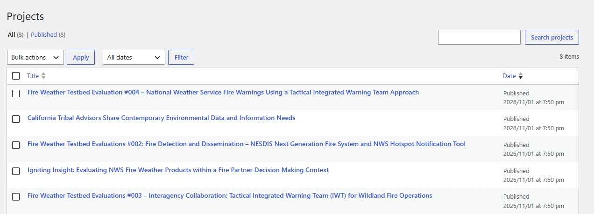
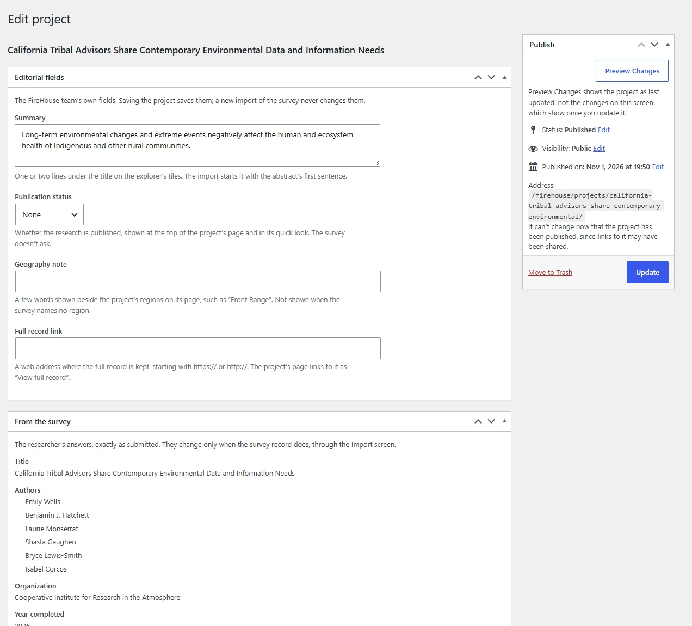

# Reviewing and publishing a project

<!-- help audience: editors; screens: project-list, project-edit -->

How to review a project, add the FireHouse team's words, publish it, and take it off the site.

## Where projects come from

Each project is one researcher's answers to the survey. An administrator brings new answers into WordPress on FireHouse → Import. A new project arrives with everything the researcher wrote, as a draft for you to review, unless the team decided before the import to publish it.

If an administrator has turned on the FireHouse survey form (FireHouse → Settings), each submission also arrives as a draft, and the team mailbox gets an email with a link to it. The email holds nothing the researcher wrote: open the draft to read it.

Soon after a submission arrives, each publication the researcher gave by DOI gets its title, journal and year under **Publications**, looked up as the import looks them up. One that couldn't be looked up shows only its DOI or address.

## Open a project

1. Go to **FireHouse → Projects**.
2. Choose the project's title. Drafts show "Draft" after their title; a project that can't be published shows "No IRB approval".

## What you can change

A project's screen has two boxes.

**Editorial fields** are the FireHouse team's own words. You can change them at any time:

- **Summary:** one or two lines under the title on the project explorer's tiles. The import starts it with the abstract's first sentence; shorten or rewrite it.
- **Publication status:** whether the research has been published, shown at the top of the project's page. The survey doesn't ask, so it starts as None.
- **Geography note:** a few words beside the project's regions on its page, such as "Front Range". Leave it empty if the survey names no region.
- **Full record link:** where the full record is kept, starting with https:// or http://. The project's page links to it as "View full record".

**From the survey** shows the researcher's answers, exactly as they submitted them. You can't change them here. If an answer needs correcting, tell the developer: the correction goes into the survey's records, you confirm it, and the next import brings it in.

A project sent through the FireHouse survey form also has a **Private answers** box on the right: the submitter's email, their job title, and how they shared their results. Only the FireHouse team and the site's administrators see it. It never appears on the site, and you can't change it.

When you've made your changes, choose **Update** (or **Save Draft** for a draft) in the Publish box.

## Publish a project

1. Read the researcher's answers and fill in the editorial fields.
2. Choose **Save Draft**.
3. Choose **Preview** to see the project's page as visitors will. Preview shows the project as last saved, which is why you save first.
4. Choose **Publish**.

The project then appears in the project explorer and in the landing page's counts, and on the topic pages once a synthesis names it.

A project can be published only if the researcher recorded IRB approval or an exemption in the survey. If they didn't, the Publish box says "This project can't be published", the Projects list marks it "No IRB approval", and you can still save it as a draft. Approval comes from the survey's records, not this screen.

> Once a project has been published, its address (its link) can't change, because people may have shared it. That's true even if it goes back to being a draft.

## Take a project off the site

- **To hide it for now:** in the Publish box, next to Status, choose **Edit**, choose **Draft**, then **OK** and **Update**. It leaves the site, and you can publish it again later.
- **To remove it:** choose **Move to Trash**. It leaves the site. To bring it back, open **Trash** in FireHouse → Projects and choose **Restore** under its title. It comes back as a draft, so publish it again.
- **To delete it for good:** in FireHouse → Projects, open **Trash**, and choose **Delete Permanently** under its title. That removes it with its fields and its revisions, and can't be undone.

Either way, it also leaves the needs that name it on the topic pages, and their project counts go down until the next synthesis.

Before you delete a project for good, tell an administrator. The next import brings back any project that's still in the survey's records, as a new project. And while a project is in the Trash, the import stops until it's restored or deleted.

## Undo a change

Each save keeps a revision. In the Publish box, next to Revisions, choose **Browse** to compare versions. Move the slider to the version you want and choose **Restore This Revision**. That puts back the summary, the publication status and the full record link as they were, but not the geography note. It never changes the researcher's answers.

## If something isn't saved

- **"Editorial fields not saved"**: a field has a problem, such as a full record link that isn't a web address. None of the editorial fields were saved, and each problem is marked. Your other changes, such as publishing it, were saved. Fix what's marked and save again.
- **"The screen had been open too long"**: the editorial fields weren't saved. They're still on the screen as you typed them: save again.
- **"This field has characters that can't be stored"**: retype the field rather than pasting it.
