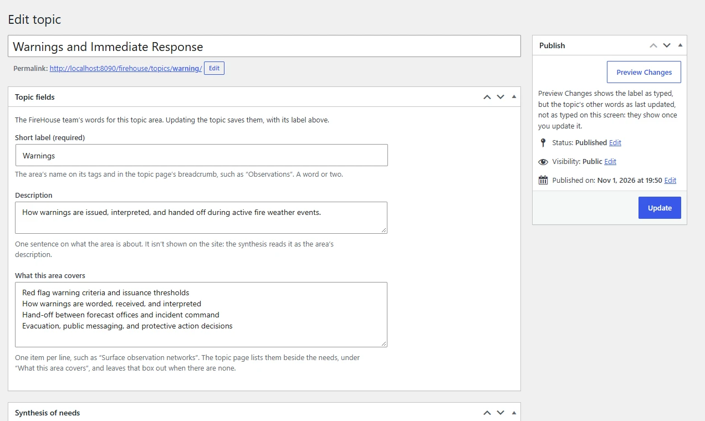

# Editing a topic area

<!-- help audience: editors; screens: topic-list, topic-edit -->

How to change a topic area's short label, description and what it covers.

## The four topic areas

Every need is grouped into one of four topic areas: Observations and Monitoring; Forecasts and Modeling; Warnings and Immediate Response; and Strategic Adaptation and Institutional Governance. There are always these four: they can't be added or removed, and their addresses don't change.

Go to **FireHouse → Topics** and choose an area's title to open it.

## What you can change

The **Topic fields** box holds the FireHouse team's words for the area:

- **Label** (at the top): the area's full name, such as "Warnings and Immediate Response". It's the heading on the area's page.
- **Short label:** a word or two, such as "Warnings", on the area's tags and in its page's breadcrumb. It's required.
- **Description:** one sentence on what the area is about. It isn't shown on the site; the synthesis reads it as the area's description.
- **What this area covers:** one item per line, such as "Surface observation networks". The area's page lists them beside its needs. Leave it empty to leave that box out.

Choose **Update** to save. The fields are saved together, all or none. If one has a problem, the screen says which, keeps what you typed, and saves none of them.

> Preview Changes shows the label as you typed it, but the area's other words as they were last updated. Update the topic to see them.

## The synthesis of needs

Below the topic fields, **Synthesis of needs** shows the area's top needs from the last synthesis, who reviewed it, and when. You can't change them here: a new synthesis replaces them, on FireHouse → Synthesis. See [Publishing a synthesis](04-synthesis.md).

Until someone has reviewed the synthesis, "Reviewed by" says "No one yet", and the area's page marks its needs "Draft, pending team review".

## Undo a change

Each update keeps a revision. Choose **Browse** next to Revisions in the Publish box to compare versions and restore one. Restoring a revision also puts back the synthesis the area had then.
