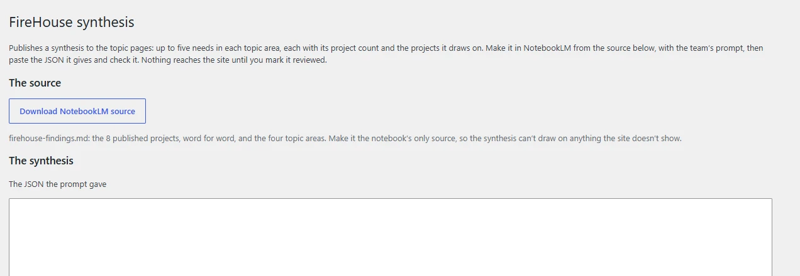

# Publishing a synthesis

<!-- help audience: editors; screens: synthesis, topic-edit -->

How to make a new synthesis of the top needs in NotebookLM, check it, and publish it to the topic pages and the landing page.

## What the synthesis is

The synthesis reads every published project together and lists up to five needs in each topic area, each with how many projects raise it and which ones. It's the one place the site puts researchers' findings in other words, so nothing reaches the site until someone on the FireHouse team has reviewed it.

Make a new one when projects have been published or taken off the site since the last.

## 1. Download the source

Go to **FireHouse → Synthesis** and choose **Download NotebookLM source**. You get firehouse-findings.md: every published project, word for word, and the four topic areas.

## 2. Run the prompt in NotebookLM

1. In the FireHouse notebook, delete the old firehouse-findings.md source and upload the one you downloaded. Keep it the notebook's only source, so the synthesis can't draw on anything the site doesn't show.
2. In the notebook's chat, run the team's prompt. It's in the [FireHouse repository's NotebookLM notes](https://github.com/NOAA-GSL/thefirehouse/blob/main/notebooklm/README.md#prompt).

## 3. Review it

NotebookLM answers with a block of text that starts with `[` and ends with `]`. Check each need against the projects it came from, with NotebookLM's citations, and edit the wording: the published words are the team's, not the model's.

- In each area, put the needs in order of their project count, highest first. For a tie, put first the need that applies across more agencies or regions.
- Each need's count must equal the number of projects it lists. If you take a project out of a need, lower its count.

Keep a copy of your edited version until it's published.

## 4. Check it

1. Copy the block, from its first `[` to its last `]`.
2. Paste it into **The JSON the prompt gave**, and choose **Check the synthesis**.
3. If the screen says "Not ready", it lists each problem. Fix them in the box and check again. Nothing is written until the check finds nothing wrong.

## 5. Mark it reviewed

When the screen says "Ready to mark reviewed", read the needs it shows. **Reviewed by** starts with your name and **Made with** with NotebookLM; change either if it isn't right. Then choose **Mark reviewed and publish**.

The topic pages and the landing page show the new synthesis at once, with today's date.

> Mark it reviewed within thirty minutes of the check, and don't open FireHouse → Synthesis again in between: either one drops the check, and you check it again.

## Undo it

Each topic area keeps the synthesis it had before as a revision. To go back, open each of the four areas under **FireHouse → Topics**, choose **Browse** next to Revisions, and restore the one before. Do all four. A restore also puts back the area's label, description and what it covers as they were then.
