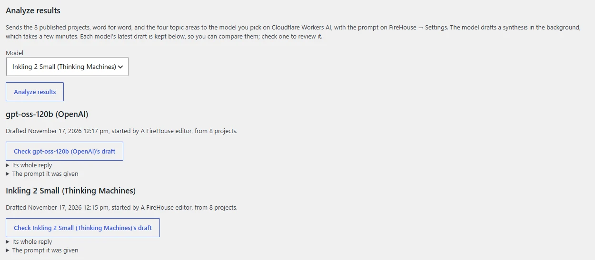
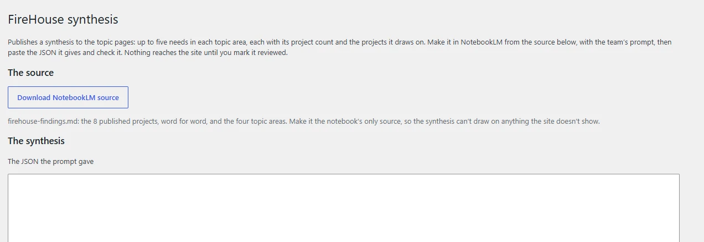

# Publishing a synthesis

<!-- help audience: editors; screens: synthesis, topic-edit -->

How to make a new synthesis of the top needs, with Analyze results or in NotebookLM, check it, and publish it to the topic pages and the landing page.

## What the synthesis is

The synthesis reads every published project together and lists up to five needs in each topic area, each with how many projects raise it and which ones. It's the one place the site puts researchers' findings in other words, so nothing reaches the site until someone on the FireHouse team has reviewed it.

Make a new one when projects have been published or taken off the site since the last.

There are two ways to make one. Either way, it goes through the same check and Mark reviewed step.

- **Analyze results**, on FireHouse → Synthesis, has a model on Cloudflare Workers AI draft it. You see it only on a site whose server has been given a Workers AI key; see the next section.
- **NotebookLM:** download the source, run the team's prompt in the notebook, and paste the result. Start at step 1.

## Analyze results

The model is sent the published projects, word for word, the four topic areas, and the prompt on FireHouse → Settings. Nothing private goes, and no earlier synthesis.

1. On **FireHouse → Synthesis**, under **Analyze results**, pick a **Model** and choose **Analyze results**. Inkling 2 Small is picked to start with: it finished the team's prompt most reliably.
2. The page says at the top that the model is drafting. It drafts in the background, which takes a few minutes, or up to a quarter of an hour longer on some sites. Reload the page to see when it's done. One model drafts at a time.
3. Each model's latest draft is kept under its name, so you can have several models draft and compare them. **Its whole reply** shows everything the model wrote, with the entries each need draws on if the model gave them: the prompt asks for them, but not every model gives them. **The prompt it was given** shows the prompt it ran.
4. Choose **Check** under the draft you want: the button names the model, as in "Check Llama 4 Scout (Meta)'s draft". Its JSON goes into the box at the bottom and is checked, as in step 4 below, and **Made with** starts with the model's name.
5. Review it as in step 3, with the model's whole reply, which stays under the needs while you check and edit, in place of NotebookLM's citations. Where the reply doesn't give the entries behind a need, read the projects the need names before you keep it. The needs table gives their titles: find each under **FireHouse → Projects**, or on the site under /firehouse/projects/. Then mark it reviewed as in step 5.

To compare models, have each draft with the same prompt, then check each in turn: the screen shows the needs each would publish. Checking one drops the check before it, so mark reviewed only the one the team chooses. A new run of a model replaces its last draft, even if the new run fails.

A draft that failed says why. Workers AI may have refused the request or be busy, or the reply may hold no JSON or have stopped at its length limit. Try again, or try another model. If one says it never started, tell an administrator: the site's scheduled events (WP-Cron) may not be running. If one says it didn't finish, try again, and tell an administrator if it happens again.

The reply is the model's, not the team's: read it as a draft. If it holds a character that doesn't show, the screen says so, since it may then read differently from what it says. If the site shows a different number of projects from the number the model read, the check of the draft says so at the top of the page, on every check of it. It compares only the number, so it can't tell when one project was published and another taken off in between: after any change to which projects are published, have the model draft again before you mark it reviewed.

## 1. Download the source

Go to **FireHouse → Synthesis** and choose **Download NotebookLM source**. You get firehouse-findings.md: every published project, word for word, and the four topic areas.

## 2. Run the prompt in NotebookLM

1. In the FireHouse notebook, delete the old firehouse-findings.md source and upload the one you downloaded. Keep it the notebook's only source, so the synthesis can't draw on anything the site doesn't show.
2. In the notebook's chat, run the team's prompt. The current prompt is in the [FireHouse repository's NotebookLM notes](https://github.com/NOAA-GSL/thefirehouse/blob/main/notebooklm/README.md#prompt).

## 3. Review it

NotebookLM answers with the needs and their citations, then a block of JSON that starts with `[` and ends with `]`. Check each need against the projects it came from, with NotebookLM's citations, and edit the wording: the published words are the team's, not the model's.

Edit the JSON in the box on FireHouse → Synthesis, or in a plain-text editor such as Notepad. Don't use Word or Google Docs: they change the quotation marks, and the screen can't read it then. A need's words are its `"text"`, its count is its `"mentions"` number, and its projects are its `"projects"` list.

- In each area, put the needs in order of their project count, highest first. The prompt lists the most important need first, so you'll usually reorder them: the check refuses any other order. For a tie, put first the need that applies across more agencies or regions.
- Each need's count must equal the number of projects it lists. If you take a project out of a need, lower its count.

Keep a copy of your edited version until it's published.

## 4. Check it

1. Copy the block, from its first `[` to its last `]`.
2. Paste it into **The JSON the prompt gave**, and choose **Check the synthesis**.
3. If the screen says "Not ready", it lists each problem. Fix them in the box and check again. Nothing is written until the check finds nothing wrong.

A model can shorten or reword a project's page slug, stop it partway, or make its own from the project's title. When a need names a project the site doesn't have, the check gives the page slug that name most likely means, with its project's title, when one clearly stands out. Change the name to it only if the need draws on that project. If that project isn't published, the check says so: take it out of the need.

## 5. Mark it reviewed

When the screen says "Ready to mark reviewed", read the needs it shows. **Reviewed by** starts with the name your account shows, and the topic pages show it to visitors: type the names as the team wants them published. **Made with** starts with NotebookLM, or with the model's name for a draft from Analyze results. Then choose **Mark reviewed and publish**.

The topic pages and the landing page show the new synthesis at once, with today's date.

> Mark it reviewed within thirty minutes of the check. If you wait longer, or open FireHouse → Synthesis again in between, the check is dropped, and you check it again.

If it says "Not published: the projects changed since the check", a project was published or taken off the site in between. The screen has checked it again: review the needs, then mark it reviewed. If it says "Not published: this check isn't waiting any more", check it again.

## Undo it

Each topic area keeps the synthesis it had before as a revision. To go back, open each of the four areas under **FireHouse → Topics**, choose **Browse** next to Revisions, move the slider one step to the left, and choose **Restore This Revision**. Do all four. A restore also puts back the area's label, description and what it covers as they were then.
