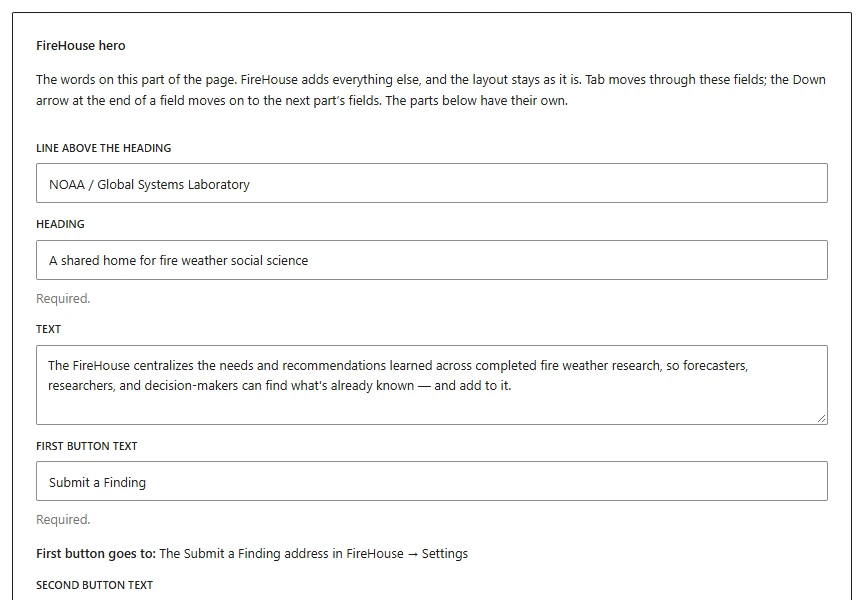

# Changing the landing and About pages

<!-- help audience: editors; screens: -->

How to change the words on the landing page and the About page, and the About page's team.

## Open a page

1. Go to **Pages**.
2. Choose **The FireHouse** for the landing page, or the About page under it.

The page opens in WordPress's block editor. Each part of the page, such as its hero (the top of the page, with the heading and buttons) or its team, is a box of text fields. Type in the fields, then choose **Save** at the top right.

Tab moves through a part's fields, and the Down arrow at the end of a field moves on to the next part.

## What you can and can't change

- **You can change the words:** headings, text, button and link text, the counts' labels, and each card's, step's and team member's words.
- **You can't change the layout:** the parts can't be added, moved or removed, and no other kind of block can be added. FireHouse adds everything else, such as the top needs, the map and the projects, from the projects and the synthesis.
- **Fields marked "Required." can't be empty:** headings, button text, names, titles and labels. An empty one is outlined in red, and a message at the top says which field to fill in, with a **Go to** button that takes you there. The page can't be saved until it's filled.
- **The Submit a Finding buttons** go to the survey address in FireHouse → Settings, wherever they are, or to the FireHouse survey form while it's open.

## The hero's counts

The landing page's hero shows counts, such as how many projects visitors can see. FireHouse counts them. **What it counts** says what each one counts; you can't change it here. **Label** and **Caption** are the words under the number. A count that counts nothing shows the words in **Shown as** instead.

## The About page's team

- **To add someone,** choose **Add a team member** at the end of the team, and fill in their name and biography. The name is required.
- **To move someone,** use **Move up** or **Move down** on their card.
- **To remove someone,** choose **Remove** on their card. Undo, at the top left, puts them back.
- **Paragraphs:** the mission and each biography can have more than one paragraph. Choose **Add a paragraph**, or **Remove** beside a paragraph.
- **Portraits:** choose one from the FireHouse portraits in **Portrait**. A new portrait is uploaded by an administrator first; FireHouse Editors don't have the Media Library. Leave **Portrait description** empty unless the photo shows something besides the person, since their name follows it.
- **The team's email address** shows on the page only if it's an @noaa.gov address.

## Preview and undo

To see your changes before saving, choose the **View** button at the top right (it looks like a screen), then **Preview in new tab**. Each save keeps a revision: in the page's settings on the right, choose **Revisions** to compare versions and restore one.
