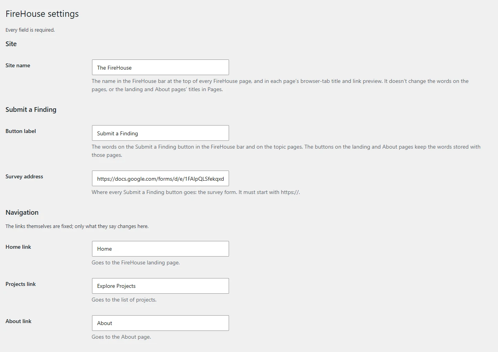
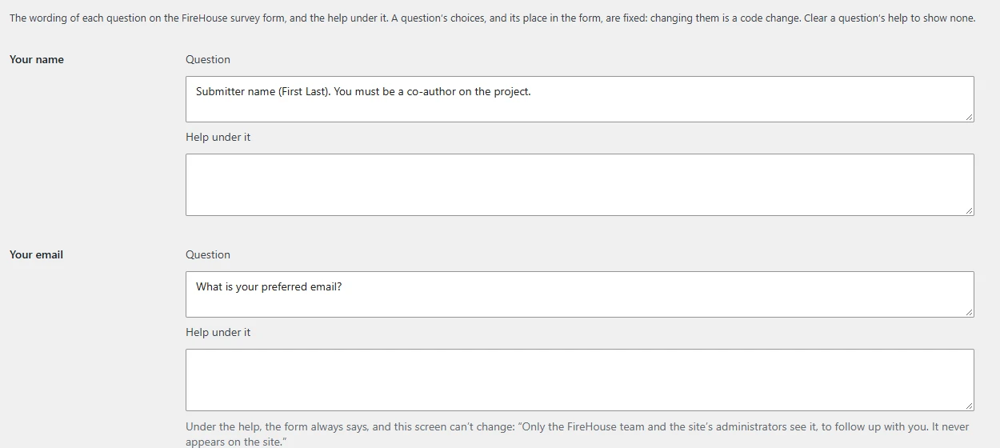

# FireHouse settings

<!-- help audience: editors; screens: settings -->

The site name, the Submit a Finding button, the navigation labels, and the survey form's questions, on FireHouse → Settings.

## What each setting does

- **Site name:** the name in the FireHouse bar at the top of every FireHouse page, and in each page's browser-tab title and link preview. It doesn't change the words on the pages.
- **Button label:** the words on the Submit a Finding button in the FireHouse bar and on the topic pages. The buttons on the landing and About pages keep the words typed on those pages.
- **Survey address:** where every Submit a Finding button goes while the FireHouse survey form isn't taking submissions. It must start with https://.
- **Survey form:** when **Accept submissions** is ticked, the FireHouse survey form at /firehouse/submit/ takes submissions, and every Submit a Finding button goes there instead. Each submission arrives as a draft project. Only an administrator can tick or clear it; for everyone else it's greyed out.
- **Home link, Projects link, About link:** the words of the FireHouse bar's links. The links always go to the same pages; only their words change here.

Choose **Save Changes** to save. If a setting has a problem, such as an empty label or a survey address that doesn't start with https://, nothing is saved, and the screen marks the problem.

## Reword a survey question

**Survey questions**, at the bottom of the screen, has a row for each question on the FireHouse survey form, named in bold. That name is what the form's error messages call the question ("Your name: this is required."), and it can't be changed, so keep your wording close to it. Each row has two boxes:

- **Question:** the question as the form asks it. It can't be empty.
- **Help under it:** the line under the question. Clear it to show none.

1. Change the words in the box.
2. Choose **Save Changes**. The form asks the new wording straight away.

A box you've changed says so under it, and gives the plugin's own wording. To put it back, copy that wording into the box and save.

Some things here can't be changed:

- **The choices and the order of the questions.** Changing those is a job for the developer.
- **Who sees a private answer.** Under the help of the email, job title and sharing questions, the form always has a line saying who sees the answer. Add help if you like; that line stays.
- **Some characters.** A question or its help can't hold an email address or a character that doesn't show, such as a direction mark.

Projects that came in before you reworded a question keep their answers, as the researcher gave them.
