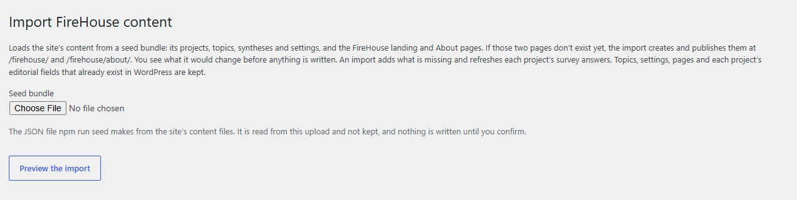

# Importing content

<!-- help audience: administrators; screens: import -->

How to load the FireHouse's content from a seed bundle on FireHouse → Import.

## What an import does

A seed bundle is one JSON file holding the FireHouse's content: its projects, topic areas, synthesis and settings, and the landing and About pages. A developer makes it from the survey's records with `npm run seed`. Only administrators can import.

An import adds what's missing and refreshes each project's survey answers. It keeps what the FireHouse team owns:

- **A new project** arrives with all its answers, published or a draft as the bundle has it.
- **An existing project** takes the bundle's survey answers, and keeps its editorial fields, its address and whether it's published.
- **Topic areas, settings and pages** that already exist are kept as they are. The landing and About pages are created, and published, only if there are none yet.
- **A project that isn't in the bundle** is left as it is.

The first import on a site loads everything. Later ones bring in new survey answers.

## Run an import

1. Go to **FireHouse → Import**.
2. Choose the seed bundle, then **Preview the import**. This is a dry run: nothing is written.
3. Read what it would change: each project, whether it would be added or updated, and any problems or notes.
4. If it lists problems, nothing can be imported. Fix them in the site's content files, make the bundle again, and upload it.
5. If it's ready, choose **Import** at the bottom of the page.

> Opening FireHouse → Import again, here or in another tab, discards the dry run. Importing the same bundle twice is safe: the second time updates the same posts.

## When an import stops

- **"It is in the trash in WordPress"**: a project in the bundle is in the Trash. Restore it, or delete it permanently, then import again. A project deleted permanently comes back as a new project if it's still in the bundle.
- **"A landing page is in the trash"**, or an About page: restore it, or delete it permanently, then import again.
- **"WordPress changed since your dry run"**: someone saved something in between. Upload the bundle again to see what an import would change now.

The uploaded file isn't kept, and the dry run waits only briefly for the import.
