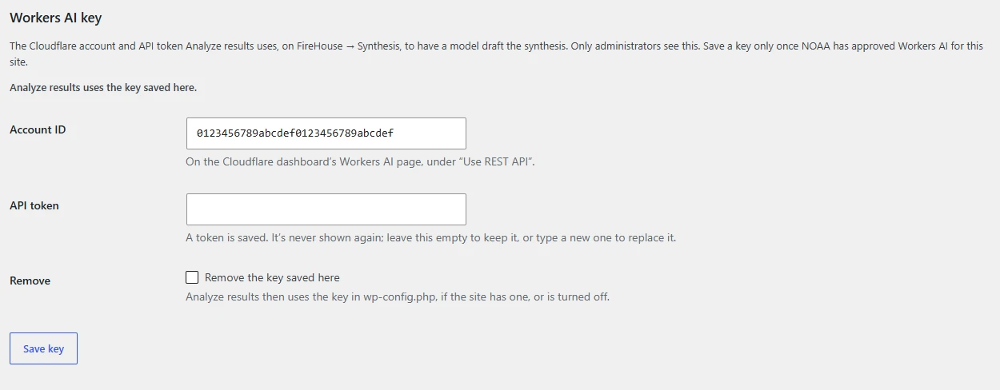

# Installing and updating the plugin

<!-- help audience: administrators; screens: -->

How to install the FireHouse plugin from its zip, update it, and what deactivating or deleting it does.

## Get the zip

Each released version's zip is attached to its release on the [FireHouse repository's Releases page](https://github.com/NOAA-GSL/thefirehouse/releases). Install only a released version on a public site: each one has passed GSL's security review.

A zip of any other commit is on that commit's "WordPress plugin" run in the repository's Actions, under Artifacts. Use those only on a local or test site.

## Install it

1. In the dashboard, go to **Plugins → Add New Plugin** and choose **Upload Plugin**.
2. Choose the zip, then **Install Now**.
3. Choose **Activate Plugin**. The FireHouse menu appears.
4. Upload the team's portraits under **Media → Add New Media File**, then load the content on **FireHouse → Import**: see [Importing content](09-importing.md).
5. Check **FireHouse → Settings**, above all the survey address the Submit a Finding buttons go to.
6. Give the people who keep the FireHouse up to date the FireHouse Editor role: see [People and portraits](10-people-and-portraits.md).

## Check it

**Tools → Site Health** lists four FireHouse checks, marked FireHouse. Open it after installing the plugin on a site, and again after anything about the server changes.

- **Outside services:** whether the server can reach doi.org and the services it sends DOI lookups on to, and Google's Agent Platform when the site has a Google API key. If one can't be reached, ask whoever runs the server to let it through.
- **Search engines:** a test or local site should keep search engines out, under **Settings → Reading → Search engine visibility**, so its pages aren't taken for the public site's; the public site should let them in. Which kind of site it is comes from WP_ENVIRONMENT_TYPE in the site's wp-config.php.
- **Page caching:** whether a cache in front of the site keeps FireHouse's pages. If it does, a project you hide stays on the pages that showed it until the cache expires: turn the cache off for /firehouse/, or tell the developer. It's marked critical when Cloudflare says it keeps them, and recommended when another cache's headers suggest one does. The server checks its own page, which may not pass through Cloudflare as a visitor's does; the check says how to look from outside.
- **Google API key:** where Analyze results' key comes from, FireHouse → Settings or wp-config.php, or that the site has none. If it says the key saved in Settings can't be read, type the API key again there (see below).

## Analyze results

Analyze results, on FireHouse → Synthesis, shows only on a site with a Google API key: a Google Cloud project ID and an API key from that project, for Gemini models on Google's Gemini Enterprise Agent Platform, formerly Vertex AI. Give the site one only once NOAA has approved the service; the [FireHouse repository's README](https://github.com/NOAA-GSL/thefirehouse#before-this-goes-public) says what to check first.

To save the key:

1. Ask GSL's IT services for the key: the **project ID** of the Google Cloud project that pays for it, and an **API key** from that project. The API key has to be bound to a service account that may use Agent Platform (the Agent Platform User role, roles/aiplatform.user), and restricted to the Agent Platform API (aiplatform.googleapis.com), so it can do nothing else. A service account's JSON key file won't do.
2. On **FireHouse → Settings**, under **Google API key** at the bottom of the screen, type the **Project ID** and the **API key**.
3. Choose **Save key**. **Save Changes**, higher up, doesn't save it.

Only administrators see that section. The API key is sealed before it's saved and never shown again: its box stays empty, and left empty keeps the saved key. To replace it, type a new one. To take the key away, tick **Remove the key saved here** and choose **Save key**; that removes it whatever the boxes above hold.

- **If saving says wp-config.php doesn't set its own AUTH_KEY and AUTH_SALT,** WordPress keeps those in the database, where a copy of it would unlock the API key, so it isn't saved. Ask whoever runs the server to set them, or to add the key to wp-config.php instead.
- **If the section says the saved API key can't be read,** the site's salts have changed since it was saved, as they do when someone resets them. Type the API key again. If they were reset because the site may have been broken into, ask GSL's IT services to delete the old API key and make a new one, and type the new one.
- **If a draft fails with "Google refused the key",** the API key may be wrong, expired, not bound to a service account or restricted to other APIs, or its service account may not have the role above in that project. Google says "API keys are not supported by this API" of any key it can't tie to a service account, whatever the reason. GSL's IT services can check.
- **A key in wp-config.php** works too, as two lines whoever runs the server adds; the README says which. A key saved in Settings comes first: remove it there to use the one in wp-config.php.

Analyze results runs in WordPress's scheduled events (WP-Cron), as a survey submission's DOI lookups do. If an editor says a draft never started, open **Tools → Site Health**: WordPress's own checks there say whether scheduled events are running late. Once the site has the key, FireHouse's Outside services check names aiplatform.us.rep.googleapis.com too.

## Update it

Upload the new version's zip the same way. WordPress shows the installed and uploaded versions side by side; choose **Replace current with uploaded**. The content and the settings stay.

An update that changes the FireHouse Editor role puts the role, and administrators' FireHouse capabilities, back as the plugin defines them. Changes made to either with a role editor don't last past it.

## Deactivate or delete it

- **Deactivating** stops the FireHouse: its project and topic pages no longer open, and the landing and About pages show none of their FireHouse parts. Everything stays in the database, and reactivating brings it back. People with the FireHouse Editor role can then only sign in.
- **Deleting** the plugin also removes the FireHouse Editor role and the FireHouse capabilities, and Analyze results' drafts; people who had the role are left with no role on the site. The projects, topic areas, settings and pages stay in the database.
